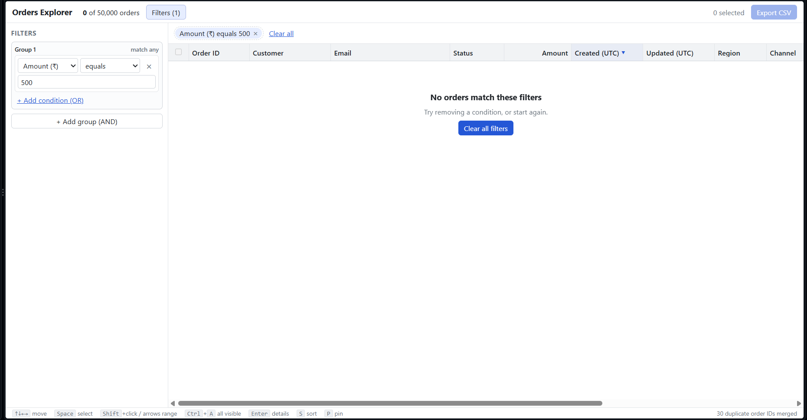
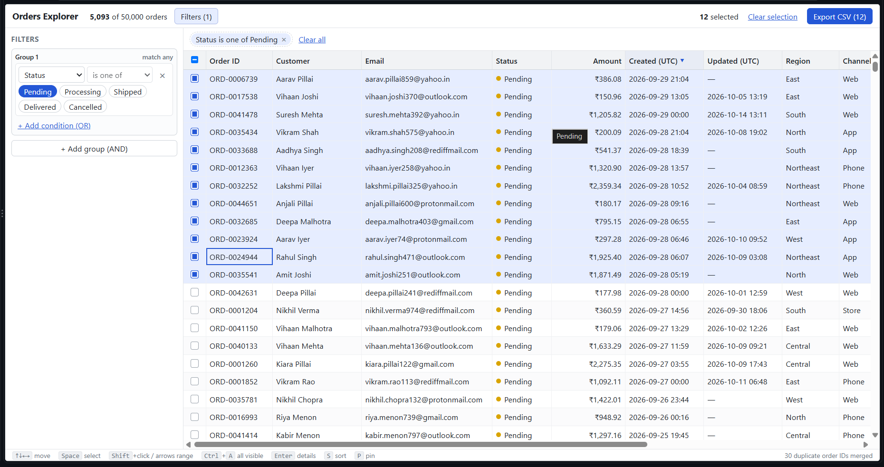

# Orders Explorer

A data grid (~50,000 orders) plus a filter builder, built with React, TypeScript and Vite. The grid, virtualization and filter builder are written from scratch.

## 1. How to run

```bash
npm install
npm run dev       # http://localhost:5173
npm test          # unit tests
npm run build     # type-check + production build
```

Node 24 (see `.nvmrc`). `orders.json` is already in `public/`.

## 2. Screenshots

Empty state (filter matches zero rows):



Main screen with data:



## 3. Dependencies

Runtime:
- `react`: UI library.
- `react-dom`: renders React in the browser.

Nothing else is used at runtime. Dev only: `vite`, `@vitejs/plugin-react`, `typescript`, `@types/react`, `@types/react-dom`, `vitest`.

## 4. Data loading

- `orders.json` is in `public/` and is fetched at runtime, not imported.
- Why: a 17 MB import would sit inside the JS bundle. As a separate file, the bundle stays small, the browser caches the data on its own, and the app can show a loading state.
- All fixes from `data-notes.md` happen in one place: `src/data/normalize.ts`. The grid and filter only see clean data.
- Result: 50,030 records become 50,000 orders (30 duplicate IDs merged).

## 5. The 200 rows question

- **What I chose:** Export gives all 200 selected rows, including the 180 the filter hides.
- **Why:**
  - The user selected those rows on purpose. Silently dropping rows from a file is worse than including them.
  - The screen is honest about it: the toolbar says "200 selected · 180 hidden by filter" and the button says "Export CSV (200)". The count on screen always equals the rows in the file.
  - If the user wants only the visible rows, "Clear selection" is one click.

## 6. Design changes

- The details panel opens over the right side of the grid instead of shrinking it, so the columns do not jump around.
- I added keyboard shortcuts that are not in the sketch: `S` sorts and `P` pins the focused column, `Ctrl+A` selects all visible rows.
- The filter panel can be hidden with the "Filters" button to give the grid the full width on a 13-inch screen.

## 7. Known issues

- Tested only in Chromium. Firefox and Safari are not tested.
- The header sort and pin buttons are not reachable with Tab. Keyboard users use `S` and `P` on a focused cell.
- Column widths are not saved in the URL.
- No drag-to-select. Selection is click, Shift+click, Ctrl+click or keyboard.
- Dates are shown and filtered in UTC, not local time.
- After converting paise to rupees, the largest order is about ₹3,640, so a filter like "amount > 5000" correctly returns nothing.
